# Repository Guidelines

## Project Overview
C++20 Tetris bot engine. It builds shared libraries (`tetris_ai`, `tetris_ai_runner`) that game hosts call through C exports, plus PSO tuning and battle executables. Bitboards; maps up to W ≤ 64 (`TetrisMap<W,H>`).

Two engines:
- `src/` (namespace `m_tetris2`): the live rewrite and the only place for new code. Rules are compile-time; searches use a Searcher + Strategy + Mixin + Hook design.
- `oracle/` (namespace `m_tetris`): the old pointer-graph engine (`TetrisContext` / `TetrisNode*`). It is the behaviour baseline for the diff tests. **Frozen: never edit `oracle/`.** The only post-freeze change is the `check_ready` corner-polarity fix (see Known state).

**Scope: all AI implementations under `src/`** — the eval(map)+GetArgs migration covers every AI in src, not one header. The 15 enumerated AIs (migration table in `eval_get_framework_plan.md` §5) are `qq::Attack`, `Dig`, `TOJ_PC`, `Botris_PC`, `TOJ_v08`, `Botris`, `TOJ`, `C2`, `IO` (`src/ai_zzz_io.*`), `the_ai_games_old`, `the_ai_games`, `the_ai_games_enemy`, `misaka`, `ai_ax`, `ai_farteryhr`; `ai_tag` (`src/ai_tag.*`) is also a src AI in scope. These run on:

| Export / tool | Rule | AI | Search |
|---|---|---|---|
| `AIPath` | `rule_st` | `Dig` | `path` |
| `TetrisAI` (`srs_ai`, plus `srs_pc`) | `rule_toj` | `TOJ_v08` / `TOJ_PC` | `tspin` |
| `BotrisAI*`, `botris`, `cmd_tris` | `rule_botris` | `Botris` / `Botris_PC` | `aspin` |
| `QQTetrisAI` | `rule_qq` | `qq::Attack` | `QQTetrisSearch` (simple/simulate/path) |
| `C2TetrisAI` | `rule_c2` | `C2` | `cautious` |
| `pso`, `top_pso` | `rule_srs` | `TOJ` | `PathStrategy` + `TSpinHook` |
| `io_uds`, `io_cmaes` (TETR.IO Season 2) | `rule_io` | `IO` (`src/ai_zzz_io.*`) | `amini` |

## Architecture & Data Flow

```mermaid
flowchart LR
  DLL["src/ai.cpp export<br/>TetrisAI / BotrisAI*"] --> Eng["TetrisEngine::run_hold<br/>(tetris_core.h)"]
  Eng --> Tree["TetrisTreeNode::run<br/>beam search, wait/sort queues"]
  Tree --> S["Searcher::search_eval<br/>(movegen_searcher.h)"]
  S --> MG["Strategy::run_piece&lt;T&gt; → MoveGen::generate<br/>(tetris_movegen.h)"]
  MG -->|"cb.operator()&lt;T,R&gt;(lp)"| Ev["attach_to_map + call_eval_typed<br/>→ AI::eval / AI::get"]
  Ev --> Best["get_best → RunResult"] --> Path["Strategy::make_path<br/>BFS + PathMark → 'lrdLRDzcx'"]
```


### Engine assembly
- The engine is `TetrisEngine<Rule, AI, SearchTag>`. Search tags (`path::`, `tspin::`, `aspin::`, `simple::`, `simulate::`, `tag::`, `cautious::Search`) are `SearchWith<Config>` and expose `type<Rule> = movegen::Searcher<XStrategy, Hook, Rule::rule_spec, Policy>`.
- The spin policy is derived from `AI::EvalSpinType` by `DeduceSpinPolicy` (`src/tetris_active_policy.h`).

### Strategies
- A strategy is a **stateless static struct** `<SpinHook, RuleSpec, Policy=void>` with static `init`, `search`, `search_eval<Cb>` and `make_path`. Each takes `Context&` first.
- `Context = MoveGenContext<RuleSpec, Mixins...>` adds no fields of its own (it inherits `Helpers<RuleSpec>`); all state lives in mixins (`BfsQueueMixin`, `detail::<name>::ExtrasMixin`). Never copy or move a `Context` out of the strategy's static methods.
- Allocate `PathMark` on the stack inside the BFS so searches stay re-entrant.
- Shared building blocks: `run_bfs` (`src/movegen_bfs.h`) and `detail::common::MakePath1gDedup` (`src/movegen_strategy.h`).

### Rules and core types
- Rules (`src/rule_*.h`) are header-only and define `TetrisRule::rule_spec = RuleSpec<...>` (`src/tetris_rule_spec.h`).
- The spawn position comes from `RuleSpec::spawn()`. The `OpDesc` x/y values are only a piece-local anchor.
- `TetrisNode` holds T and R at compile time; only x and y exist at runtime.
- **Map polarity:** in `src/`, `TetrisMap` stores 0 = occupied. `set` / `get` / `none` / `max_y` and the set operators (`|`, `&`, `~`, …) mean "occupied"; `row()` / `set_row()` expose the raw 0 = occupied bits, and `occupied_row(y)` is the 1 = occupied view. Host rows and test fixtures written as 1 = occupied go in as `set_row(y, row_full ^ occupied)`. In the oracle, 1 means empty.
- **Board size is compile-time:** `prepare(w, h)` only accepts the `RuleSpec`'s own size (10×40; `rule_c2` 10×28). The oracle accepted any size for `rule_st`, `rule_qq` and `rule_tag`. As a result, `AIPath` and `QQTetrisAI` return no move when the host passes a different size (for example QQ 12×21), and `vs` crashes for the same reason. This is a known limitation and has deliberately not been fixed.

### AI contract
AIs live in `src/ai_*.h/.cpp`. The engine detects members with SFINAE and `requires`; there are no registration macros.
- **Required (eval(map) + GetArgs contract; reference `docs/eval_get_framework.md`):**
  - a nested `Result` (any type — `double`, a struct, or an empty type);
  - `template<class Spec> void init(Config const*)`;
  - `ai_name()`;
  - a templated const `eval(MapT const& map)` — a pure post-map function of the bound, locked `Config`. It must not read the landing piece, clear, spin, parent `Status`, source map, depth, hold/next, or write external state; it may read the bound `Config const*`.
  - `GetArgs = m_tetris2::type_list<...>` listing exactly the providers `get` consumes (`args::Eval<Result>`, `args::Clear`, `args::Landing<L>`, `args::Parent<Status>`, `args::Depth`, `args::MapBefore`/`args::MapAfter`, `args::NextNode`/`args::NextLength`/`args::NextView`, `args::Hold`, `args::Env`). The engine extracts only listed providers; an unlisted provider is not computed.
  - one const `get(...)` whose parameters match the `GetArgs` tags in order.
- `Status` needs `operator<`.
- **Optional:** `Config`, `ratio()`, `iterate()`, `EvalSpinType`.
- **No `Status::transposition_key()`:** same-depth transposition pruning is removed. `get` consumes the whole placement sequence (accumulators such as `like`/`value`/`b2b`/`combo`), so per-position keyed dedup is unsafe.
- **Eval caching:** because `eval` depends only on `(map, Config)`, the engine caches it per `Context` in `EvalCache<MapT,Result>` — direct-mapped, hash locate + full raw-map equality, single-bucket overwrite, `generation` epoch on a Config change. A cache hit does not skip `get`; `scored()` still counts every `get`.
- Template members go in the header. `get`, `ai_name` and `Status::operator<` go in the `.cpp`.

### Runtime details
- `TetrisThreadEngine` keeps a background search running. Wrap every foreground call in the `PauseBackground` RAII guard; its destructor wakes the worker. The argument-free `run()` / `run_hold()` widen the last searched position. Its `update()` takes effect at the next `run` / `run_hold`, after the host's status and configs are copied in; earlier, the worker could rebuild the beam with the old ones.
- `commit(result)` tells the engine the host plays `result`: the other root moves are dropped, so background thinking explores only the position after it, and the next search reuses that subtree when the board matches. Hosts that search the same position twice (the PC engines in `src/ai.cpp`) must not commit in between.
- `TetrisEngine::scored()` counts positions scored (`AI::get` calls) since the beam last restarted; `complete()` says widening adds nothing more.
- Discarded subtrees are freed lazily (freeing costs ~0.1 µs per node): `alloc` splits them into the free list as it needs nodes, and each argument-free `run()` / `run_hold()` frees a batch before widening. `memory_usage()` counts them until then.
- A Searcher holds state, so use one instance per thread.
- `search()` is the hot path; `make_path()` is not.

### TETR.IO Season 2 bot
- Game rules: `.research/tetrio-s2-rules/rules.md` (verified against the live client and a ranked replay). Code follows it, not wikis or Triangle.js.
- `src/rule_io.h`: SRS+ kicks incl. 180°, spawn flat row = board row 21. `src/search_amini.h` (`amini::Search`): spin classes `None/Mini/Full` per runtime `Config::spin_rule` (`TSpins`, `TSpinsPlus`, `AllMini`, `AllMiniPlus`); one LandPoint per realizable class at the same cells, and `make_path` reproduces exactly that class.
- `src/io_rules.h`: all S2 arithmetic (attack, B2B/surge, combo, all clear, garbage queue/cap/opener, multiplier ramp, Park–Miller bag and hole RNG). The AI, simulator and server never re-implement it.
- `ai_zzz::IO` host API: `IO::make_root_status(RootState, Config)`, then `engine.update()` before every search (the engine does not compare Status/Config). `RootState::frame` is the frame at which the root placement **locks**; pending-garbage timers count from that frame. B2B/combo use TETR.IO client counters (Triangle `stats.b2b + 1`, `stats.combo + 1`).
- `ai_zzz::IO` evaluation treats every piece's spins alike, as the S2 rules do: spin rewards are keyed by class × lines (`mini_k`, `full_k`), never by piece. Spin opportunities come from `src/ai_zzz_io_spin_slots.h` (line-clearing spins reachable by hard drop + one rotation, classified by the search's own `AMiniRuleHook`), valued as `slot_b2b + slot_attack · io_rules::kBaseAttack` and discounted by `slot_decay` per piece of distance in hold/preview. `IO::search_spin_rule` is the single `spinbonuses` → `SpinRule` mapping (io_uds and the detector). Rationale and measurements: `.research/s2-allspin-eval/plan.md`.
- Kills: `src/ai_zzz_io_lethal.h` (`IOLethal`) searches the opponent's replies and returns `OpponentView::lethal_sent`, a bitmask over lines our root placement sends (bit X = certain kill); unmodelled cases count as survival. `IO::get` credits a kill only at depth 0 and adds a fixed `kKillValue` (no chain refund). Surge sent to the opponent is valued at `surge_release` × attack; cancelled surge keeps `cancel`.
- `src/io_sim.*`: S2 1v1 simulator. Each seat has a `Pace`: constant cadence (lock k at `floor(k * 60 / pps)`) or the bot client's burst cadence (an exact port of botconnect's `Minion::next_frame`: sooner with a high stack, queued garbage or a combo, averaging the nominal pps); the AI always plans with the nominal pps. `MatchConfig` defaults: 4 pps constant, 10 previews, 32,768 positions scored per placement (`budget.nodes`, deterministic and equal for every `ratio`).
- `src/io_league.*`: shared by the trainer and `io_eval`: builtin policies (`default`, `spiker`, `staller`) or param files, pace text (`2.5` constant, `2.5b` burst), disjoint seed streams (training, validation, test), a parallel runner whose result i belongs to game i whatever the thread count, clustered/paired statistics, the per-game CSV.
- `src/io_cmaes.*`: sep-CMA-ES trainer over `IO::param_fields()` minus `--freeze` (default `ratio`). Each generation deals league groups (opponent: the current mean, an anchor or a hall-of-fame entry; own pace, default `1.5b,2.5b,3.5b`; opponent pace = own × ratio, default `1,1.25,1.5`, burst cadence) from a shuffled deck; every candidate plays each group on its own seed, both seats. Every `--validate-every` generations the mean and the champion play the same fresh validation panel (new seeds each round, so the comparison is paired and not inflated by the champion's own selection); the mean becomes the champion (`best.params`, also added to the hall of fame) when its paired advantage reaches `--promote-z` standard errors; `mean.params` is the distribution mean. Default λ gives each worker ~30 games per generation and is fixed for the run; results do not depend on `--workers`. Groups per generation double while the split-half reliability of the ranking stays below 0.3. The checkpoint stores the whole scenario, so `--resume` takes only `--workers`, `--hours`, `--generations`, `--out`; `--hours 0` runs until SIGINT/SIGTERM. Design, measurements and the v1 → v3 changes: `.research/io-cmaes-training-quality/plan.md`.
- `src/io_eval.cpp`: every listed policy plays the same panel (opponents × own paces × ratios, or `--legacy`: own 4 pps against default@4, spiker@4, staller@6) on test seeds; prints per-group scores and pairwise paired differences with 95% intervals.
- `src/io_uds.cpp`: protocol v4 socket server for the TETR.IO bot client (a sibling repo; its `src/services/ipc/protocol.ts` documents the JSON) and that client's TEST-field player (`bun run play-test`, `src/browser/`). Each `prepare` builds a fresh engine; every move it plays is committed, so background thinking runs on the next position. Speed belongs to the client: each move carries `pps` (the speed evaluation plans for) and `think_ms` (the most time from reading the request to sending the reply; the search gets what is left after parsing and the kill analysis, minus a 2 ms reserve). `--lethal-free-pieces N` (default 2) is how many opponent placements may lock before our garbage can enter; a move's optional `lethal_free_pieces` overrides it for that move (the client's `lethal` command). `io_sim` derives it from both speeds instead. How to run everything: the client's `CHEATSHEET.md` (its `bun start` launches `build-rel/io_uds`).

## Key Directories
- `src/` prefix rules:
  - `movegen_*`: neutral shared machinery.
  - `search_*`, `rule_*`, `ai_*`: concrete end-to-end implementations only, never reusable helpers.
  - `tetris_*`: core types.
  - `chash*`, `rb_tree.h`, `sb_tree.h`: utility containers.
- `tools/aspin_dump [out]`: run before and after a refactor and diff the two outputs byte for byte.
- `.research/flip-bits-cleanup/{phase_a_truth,c5_followup}.md`: the reasoning behind the diff harness protocol, cited by `test/_diff_harness.h`.

## Development Commands
```sh
cmake -S . -B build -DCMAKE_BUILD_TYPE=Debug      # Debug is required for tests: Release defines NDEBUG and adds -flto
cmake --build build -j                            # every target, including the diff drivers and dummy_strategy_compile_check
cmake --build build -j --target tetris_ai         # the only target CI builds
ctest --test-dir build --output-on-failure        # all registered tests
ctest --test-dir build -R '^tetris_diff_tspin_diff$' --output-on-failure
TETRIS_DIFF_VERBOSE_INFO=1 ./build/aspin_diff     # also dump the [INFO] set differences
./build/perft_movegen all | sort | uniq           # inspect move generation
cmake -S . -B build-rel -DCMAKE_BUILD_TYPE=Release -DTETRIS_IO_UDS=ON   # io_uds downloads nlohmann_json; off by default
cmake --build build-rel -j --target io_uds io_cmaes io_eval
TETRIS_AI_SOCKET=tetris_ai ./build-rel/io_uds   # param file: prepare.params (client: env TETRIS_AI_PARAMS); the client's `bun start` runs it
./build-rel/io_cmaes --hours 6 --out io_cmaes_out [--init best.params]   # train in Release; --hours 0 runs until stopped; see --help
./build-rel/io_cmaes --resume --out io_cmaes_out --hours 0                # continue a run (any core count)
./build-rel/io_eval io_cmaes_out/best.params default --seeds 16           # paired comparison on test seeds; see --help
```

- `-DORACLE=ON` builds the production DLLs from `oracle/` instead of `src/`; include order then makes `"tetris_core.h"` resolve to the oracle copy.
- `-DTETRIS_CONSTEXPR_OPS_LIMIT=N` raises the compile-time evaluation limit for `extreme_rule_diff`.
- CMake is the only build system, Windows included. Non-Debug, non-MSVC builds append `-flto`.

## Code Conventions & Common Patterns
- **Simplicity:** write simple code. Prefer simplicity over complexity, and keep the codebase easy to maintain.
- **Formatting:** `.clang-format` applies.
  - `SortIncludes: Never`: never reorder includes. `.clang-format-ignore` skips `oracle/` and `src/chash*.h`.
  - clang-format still mangles `requires` expressions nested in `enable_if_t` template arguments (`src/tetris_core.h`, `src/movegen_hook.h`) and fold expressions over immediately-invoked lambdas. Format only the lines you touched and check the result.
- **Static analysis covers only `ai_zzz`** (`src/ai_zzz*` and a future `src/ai_zzz/`). `.clang-tidy` reports headers matching that path; `.clangd` suppresses every other file. With `-DCMAKE_EXPORT_COMPILE_COMMANDS=ON`, each build writes the `ai_zzz` subset of `build/compile_commands.json` to the root `compile_commands.json` (target `ai_zzz_compile_commands`, `cmake/filter_compile_commands.cmake`), which `run-clang-tidy -p .` and `omp cleanse` use. clangd reads the full `build/` database.
- **Comments:** let names and structure carry the meaning, and write no comments by default. Add one only when the code is non-trivial and the comment is the sole way to convey a non-obvious *why* (invariant, hardware/compiler workaround, rule-spec quirk). A comment that restates what the code does has no place.
- **Naming:** engine types PascalCase, functions snake_case, private members trailing `_` (`ctx_`), constants `k` prefix (`kW`). Utilities live in namespace `zzz`.
- **Header guards:** `#pragma once` or `TETRIS_AI_RUNNER_*_H_`. Several files start with a UTF-8 BOM; keep it.
- **Errors:** use `static_assert`, `assert` and `bool` returns. The only exceptions are in `chash.h`.
- **Compile-time dispatch:** everything is templated on piece `T` and rotation `R`. Use fold expressions inside each strategy and `[&]<char T, uint8_t R>` callbacks into `TetrisCallEval::call_eval_typed` (`src/tetris_eval_dispatch.h`).
- **SIMD:** `simd::BoardVec` is a plain `std::array` with element-wise loops that the compiler auto-vectorises. No intrinsics, no `-march` flags; it must build on macOS arm64.
- **Include-order traps:**
  - `tetris_eval_dispatch.h` must be included outside any namespace (see `tetris_core.h`). Its `TSpinType` / `ASpinType` / `AMiniType` enums must mirror `search_tspin.h` / `search_aspin.h` / `search_amini.h`.
  - `search_tspin.h`, `search_aspin.h` and `search_amini.h` are included twice on purpose. The second pass expands their tags after `TETRIS_AI_RUNNER_SEARCH_PATH_TAGS_READY_` is defined.
- **Banned:** reintroducing the `Hook::is_simple_search` / `is_simulate_search` flags, and moving a strategy's own Neighbors / Dedup / Visitor into shared `movegen_*` code.
- **Path keys:** `l r d L R D z c x`. Trailing `d`/`D` are stripped; the DLL appends `v` for hold and `V` as the terminator.

## Important Files
- `src/ai.cpp`: the DLL exports as `extern "C"`. Engines are globals, configured by the `USE_V08` / `USE_THREAD` / `USE_PC` macros. `src/ai.def` is intentionally empty.
- `src/vs.cpp`: a console battle and speed-test harness that loads AI DLLs (`vs <a.dll> <b.dll>`, or `vs <dll>` for the speed test).
- `.github/workflows/main.yml`: CI builds `tetris_ai` only (Debug and Release; ubuntu gcc-14, macOS, Windows MSVC) and runs no tests, so verify locally. It publishes releases on `pre*` / `v*` tags.
- `docs/extending_search.md` and `examples/dummy_strategy.h`: the recipe and worked example for adding a search. They match the current API. `dummy_strategy_compile_check` builds and runs the example under ctest (`tetris_dummy_strategy`), so changing the movegen API without updating them breaks that test.

## Workflow
- Commit messages follow Conventional Commits. Don't push without the user's OK.
- `TODO.md` tracks pending work. Record each task you defer under `## Open` as `- [ ] <task>`. When it is done, move it to `## Done` as `- [x] YYYY-MM-DD <task>` (the completion date). Before every commit, delete Done items completed more than 7 days before the commit date.

## Testing & QA
- Each test is an executable whose `main` returns 0 to pass. Unit tests use `static_assert` and `assert()`, so build them as Debug.
- **Diff tests** (`test/_diff_harness.h`, `tetris_diff::run_diff_main`) compare the `src/` searches against `oracle/` on 34 fixed 10×40 boards for the pieces `OITLJSZ`.
  - **Phase A:** the oracle's landing set must be ⊆ the candidate's set. Extra tuck landings found only by `src/` are logged as `[INFO]`, not failures.
  - **Phase B:** `make_path` output must be byte-equal once trailing `D`/`d` are stripped. With `PhaseBPolicy::IgnoreDrift`, any mismatch counts as drift, not failure, and the harness does **not** replay paths. A wrong path is therefore also reported as drift (for example `src/search_tag.h:1084`, which is outside the ai_zzz scope). When you change `make_path`, replay the paths yourself.
  - **Oracle kick repair:** the oracle copies `rotate_*` pointers from neighbouring nodes (`oracle/tetris_core.cpp:328-381`), so a bogus kick #0 wins: T-spins are misclassified in 1g and extra landings appear in 20g. Each oracle-backed driver calls `tetris_diff::repair_oracle_wall_kicks(ctx)` right after the oracle `prepare()`. New drivers must call it too.
  - `simple_diff` compares `SimpleStrategy` with `PathStrategy` and always exits 0. Its Phase A fails are the expected tuck landings that `SimpleStrategy` cannot reach.
- `perft_movegen` and `extreme_rule_diff` (oracle side skipped) are smoke tests that always exit 0. `perft_movegen all | sort | uniq` gives 162 lines: O 9; I, S and Z 17 each; T, L and J 34 each. Placements that cover the same cells are merged.
- **Adding a diff test:**
  1. Copy an existing `test/*_diff.cpp` as `test/<name>_diff.cpp`. Spawn comes from `RuleSpec::spawn`, keys from `Helpers::cells_key_from_oracle` / `cells_key_for_state`.
  2. Implement a `CaseProbe` that fills `oracle_lps` and `candidate_lps` with `LpEntry`, plus `*_make_path` closures for Phase B, and call `run_diff_main` from `main`.
  3. Add `<name>_diff` to **both** `foreach` lists in `CMakeLists.txt` (build and `add_test`). It registers as `tetris_diff_<name>_diff`.
- **Adding a unit test:** `add_executable` it (without `EXCLUDE_FROM_ALL`), link `tetris_core`, and register it with `add_test(NAME tetris_<x> COMMAND x)`.
- `tetris_engine_regression` (`test/engine_regression_test.cpp`) is built with ASan/UBSan on non-MSVC compilers. It covers the `AIEnv` queue seen by `get` (hold swaps, `iterate` with a held tail), T-spin `LandPoint.type`, the 3-corner table, `TetrisEngine::attach`, a lowered active piece (path and amini), widening from a fresh engine's first search, and `commit`. (The former per-depth transposition-skipping case is removed along with transposition pruning.)
- **Search start:** `run` / `run_hold` search the root's active piece from the passed `TetrisBlockStatus` (x, y, r); held and preview pieces start at `RuleSpec::spawn`. `MoveGen::generate` takes that start as a bitboard `State`. A new start drops the root's cached children.
- **Failing diffs:** never hide an unexpected failure with `XfailSet` entries. Investigate and report it.
- **T-spin classification:** a corner counts when it is occupied or out of bounds. `TSpinHook` stores in `LandPoint.type` the class a one-line clear would score: Mini if `is_mini_ready`, else TSpin if `is_ready`, and only when `is_last_rotate`. `TOJ` / `TOJ_PC` / `TOJ_v08` convert it per clear count with `ai_zzz::tspin_for_clear` (no clear → None, Mini on 2+ lines → TSpin), matching the oracle AIs' `get`.
- **Oracle corner fix (2026-10):** `check_ready` in `oracle/search_tspin.cpp` and `oracle/search_tag.cpp` counted set bits of the 1=empty oracle map, which means empty corners. `src/` had the same inversion in `TSpinHook::corner_ct`, so `tspin_diff` / `tag_diff` agreed on the wrong answer. Both sides now count occupied corners (`~map.row` in the oracle). The diff summaries are unchanged.
- **Known state (2026-10-29, HEAD 037125c4 — prior semantic acceptance vetoed by the user):** the eval(map)+GetArgs framework (`src/tetris_eval_get.h`) has landed and all 15 src AIs are migrated to the new contract; transposition pruning is fully removed (no-prune behavior covered by a standalone repeats-500x test). Commit chain on `dev` (not pushed): `7af0537a` (old C2 baseline) → `4b2d506a` (15-AI migration) → `3770535e` (cache hardening) → `037125c4` (docs/comment-only). Working tree tracked edits: this doc's own docs, the long-protected `src/ai_ax.h` guard/polarity two-hunk (pre-existing, kept independent), and in-progress `src/tetris_core.h` / `src/tetris_eval_get.h` EnableEnv fixes (not committed, not deployed).
  - **Distinguish fact from conclusion.** The following are valid, real historical run records — they happened and their hashes are correct: engine groups 3+5+7; per-AI diffs A 384 / B 52 / D (misaka 121500, ax 18000, farter 3600) / C golden (241 lines, 240 cases / 2460 obs matched); core counter/wrap/tree 80→160; serial 36/37; full Debug rc0 41 tests / 40 pass / 1 fail; 8 two-cycle loads; 12 fresh C2 NextDPPolicy; four fat libs 36c6febe (size 1 843 728, name `C2 ZZZ / 3770535e346f-dirty`, version `8.4.0-generation-10ms`). **What was vetoed is the upgrade of these records into a "migration is semantically equivalent / complete" conclusion** — that conclusion overreached because of the open regression below. The numbers remain as dated history, not as current equivalence evidence.
  - **Open regression — virtual env / EnableEnv:** `GetArgsInvoker::operator()(args::Env)` ignores `EnableEnv` and always calls `env<true>`; the O(1) providers (`NextView/NextLength/NextNode/Hold/IsHold`) read real values with no virtual gating. Old `7af0537a` `run_virtual` called `get<false>` → `env<false>` returned `{nullptr,0,' ',' ',false}`. On virtual expansion nodes, C2 computes `length_ratio = (1<<((next_node!=' ')+next_length))*0.5` as 64 where the old empty-env value would give 0.5. The five whole-`args::Env` AIs (TOJ_v08, Botris, TOJ, IO, misaka) likewise read real parent hold/queue on virtual nodes. As a conditional historical example (root combo=3, combo_limit=10, `?T?` queue — not a universal multiplier), one logged virtual child attack moved from ~-4712.9 (fixed empty env) to ~-1.65M (buggy real env); exact factor depends on that node's inputs. Evidence: `research/eval_get_virtual_env_correction/` (REPORT_C2_VIRTUAL_ENV.md, old_env_semantics_audit.md). The production fat libs (36c6febe / 3770535e) still contain this bug; a scratch fixed build ran 5/5 but is **not** the deployed artifact.
  - **Status: deployment complete for the requested fix scope (label `e0731c6ccbb2`); NOT all-green / NOT universal 15-search equivalence.** Commit `e0731c6ccbb2bbc19751f8c7f08499a20d69895f` (`fix(core): preserve virtual env and invalidate config search state`, identity `C2 ZZZ / e0731c6ccbb2` no dirty); new fat `8144cd85…fd431` (1,860,720 B, arm64+x86_64 four authorized paths same hash) deployed, arm64 dlopen rc0. Three issues (virtual-env gating, Config invalidation, root eval-slot residual) fixed; strict 9-case 165056 all match; DP e073 rebuild 12-fresh 46/0 rc0 (true combo 5 / 500ms / this-step attack not clipped). Boundaries: full suite 1 known fail (safe_regression BPM generation assert not削); x86_64 dynamic still blocked by arm-only injection, unverified; GUI complete-match / TSan / perf untested; semantic GO is limited fixture/node coverage. Upper real App lib `34f546d…` untouched; Java/JAR/ax protected hashes original. Old 36c6febe and candidate 44854a21 are unused history. Subsequent: docs-only commit (unified identity, no push, no Java 3 diagnostics).
  - **This round: candidate fat built but not deployed; no commit, no push.** Production four fat libs (`36c6febe`, 3770535e) still carry the virtual-env bug; the in-progress EnableEnv fix lives only in the uncommitted working tree. Stage numbers (candidate fat `44854a21` / 1,860,560 B / identity `037125c480ac-dirty`, Debug 41/40/1 rc8, arm64 two-cycle smoke rc0, x86_64 dynamic blocked by the dyld arm-only injected lib, NextDP 12-fresh 46/0 internal smoke non-strict) are recorded in `docs/eval_get_framework.md` status block and the project-root report, not duplicated here. Standing constraints: the pre-existing `cultris_safe_regression` generation assertion (120→121) still fails and is **not cut**; C2 is **not closed** (old-6 recompile is stage evidence only; old/new Engine provider input/Result/Status bit-per-chain plus a fault negative control are owed — build/smoke must not be rewritten as C2 closure); x86_64 dynamic is blocked, so do not claim new dual-arch dynamic green. GUI complete match / TSan / wall-ms perf-strength not run. Not claimed: all-search semantic equivalence, ASan data-race clean, whole-search path equivalence (cache on/off checked only at limit-0), wall-ms strength, optimal cache bucket size. Upper-App overwrite remains unrecovered (currently 34f546d; backup 9c9d16ed matched, restore unauthorized — zero writes to that path). Open issues, not fixed:
  - **Independent audit stage (partial, not closure).** 10/15 production AIs full-engine per-field floatbit match on 7 boards (qq::Attack, Dig, TOJ_v08, Botris, TOJ, TOJ_PC, Botris_PC, IO, tag, enemy); tag/enemy b4 high-stack topout is a shared invalid result (both sides return no-legal-landing), not a semantic diff. The 4 Env consumers have no iterate method, so the engine only calls `get<true>` (real env, vg=0 by design); `get<false>` is unreachable for them in the engine layer — the provider gating contract is unified, but their production path is not claimed to have been hit by the virtual bug. `direct_get` is an AI direct-call fixture, not a Core-provider proof. misaka Core boundary: real1/virt1 env2 Status bits now match old/new. Nonprod fixtures: pure-migration old/new definable sections 29/30 matched; ai_ax empty-board old UB is single-column. The protected ai_ax hunk really changes b2-7 (-75,-25,-1000,-60,-2000,-45) — it is carried neither forward nor fixed. Config TOJ+IO single-bucket: A old/new bits consistent; setting cfgB gen2→3 makes new rerun == new freshB == old freshB bits (new honors explicit invalidation; old same-map mutable cfgB+update still returns A, the old reuse-tree behavior); hit=0, so only fresh convergence is shown — do NOT claim full-map hit/iterate/frontier verified. Still owed: the formal old/new full C2 engine trace (now re-running). Evidence: `research/independent_audit_resume/AUDIT_MATRIX.md`, `research/nonprod_resume_20261029/REPORT.md`, `research/config_resume_20261029/REPORT.md`.
  - the board-size limitation above;
  - `TSpinHook::try_kick_pred` (`src/movegen_hook.h`) can record an `lp.last` source whose real rotation lands elsewhere. Nothing compares this field, and it only matters when `last_rotate` is enabled, which no production config does;
  - `aspin_diff` has 34 uninvestigated `[INFO]` candidate-only landings (12 T in 1g);
  - `amini`: an O spawning inside an enclosed pocket can rotate in place for a Mini in TETR.IO; `rule_io` gives O no rotation, so that spin is never found. Paths ignore the 15 lock-reset limit and gravity between keys;
  - root search with hold: when the held (or, with an empty hold, the next) piece has the active piece's type, only the active piece's own position is searched, not a fresh spawn of the same type.
