# Repository Guidelines

## Project Overview
C++20 Tetris bot engine. It builds shared libraries (`tetris_ai`, `tetris_ai_runner`) that game hosts call through C exports, plus PSO tuning and battle executables. Bitboards; maps up to W ≤ 64 (`TetrisMap<W,H>`).

Two engines:
- `src/` (namespace `m_tetris2`): the live rewrite and the only place for new code. Rules are compile-time; searches use a Searcher + Strategy + Mixin + Hook design.
- `oracle/` (namespace `m_tetris`): the old pointer-graph engine (`TetrisContext` / `TetrisNode*`). It is the behaviour baseline for the diff tests. **Frozen: never edit `oracle/`.** The only post-freeze change is the `check_ready` corner-polarity fix (see Known state).

**Scope: only `ai_zzz` matters** (`src/ai_zzz.h/.cpp`). Ignore the other AIs (`ai_tag`, `ai_misaka`, `ai_farter`, `ai_ax`) and the code that serves only them (`tag::Search`, `the_ai_games`, `demo`). ai_zzz runs on:

| Export / tool | Rule | AI | Search |
|---|---|---|---|
| `AIPath` | `rule_st` | `Dig` | `path` |
| `TetrisAI` (`srs_ai`, plus `srs_pc`) | `rule_toj` | `TOJ_v08` / `TOJ_PC` | `tspin` |
| `BotrisAI*`, `botris`, `cmd_tris` | `rule_botris` | `Botris` / `Botris_PC` | `aspin` |
| `QQTetrisAI` | `rule_qq` | `qq::Attack` | `QQTetrisSearch` (simple/simulate/path) |
| `C2TetrisAI` | `rule_c2` | `C2` | `cautious` |
| `pso`, `top_pso` | `rule_srs` | `TOJ` | `PathStrategy` + `TSpinHook` |
| `io_uds`, `io_pso` (TETR.IO Season 2) | `rule_io` | `IO` (`src/ai_zzz_io.*`) | `amini` |

## Architecture & Data Flow

```mermaid
flowchart LR
  DLL["src/ai.cpp export<br/>TetrisAI / BotrisAI*"] --> Eng["TetrisEngine::run_hold<br/>(tetris_core.h)"]
  Eng --> Tree["TetrisTreeNode::run<br/>beam search, wait/sort queues"]
  Tree --> S["Searcher::search_eval<br/>(movegen_searcher.h)"]
  S --> MG["Strategy::run_piece&lt;T&gt; → MoveGen::generate<br/>(tetris_movegen.h)"]
  MG -->|"cb.operator()&lt;T,R&gt;(lp)"| Ev["attach_to_map + call_eval_typed<br/>→ AI::eval / AI::get"]
  Ev --> Best["get_best → RunResult"] --> Path["Strategy::make_path<br/>BFS + PathMark → 'lrdLRDzcx'"]
```


### Engine assembly
- The engine is `TetrisEngine<Rule, AI, SearchTag>`. Search tags (`path::`, `tspin::`, `aspin::`, `simple::`, `simulate::`, `tag::`, `cautious::Search`) are `SearchWith<Config>` and expose `type<Rule> = movegen::Searcher<XStrategy, Hook, Rule::rule_spec, Policy>`.
- The spin policy is derived from `AI::EvalSpinType` by `DeduceSpinPolicy` (`src/tetris_active_policy.h`).

### Strategies
- A strategy is a **stateless static struct** `<SpinHook, RuleSpec, Policy=void>` with static `init`, `search`, `search_eval<Cb>` and `make_path`. Each takes `Context&` first.
- `Context = MoveGenContext<RuleSpec, Mixins...>` adds no fields of its own (it inherits `Helpers<RuleSpec>`); all state lives in mixins (`BfsQueueMixin`, `detail::<name>::ExtrasMixin`). Never copy or move a `Context` out of the strategy's static methods.
- Allocate `PathMark` on the stack inside the BFS so searches stay re-entrant.
- Shared building blocks: `run_bfs` (`src/movegen_bfs.h`) and `detail::common::MakePath1gDedup` (`src/movegen_strategy.h`).

### Rules and core types
- Rules (`src/rule_*.h`) are header-only and define `TetrisRule::rule_spec = RuleSpec<...>` (`src/tetris_rule_spec.h`).
- The spawn position comes from `RuleSpec::spawn()`. The `OpDesc` x/y values are only a piece-local anchor.
- `TetrisNode` holds T and R at compile time; only x and y exist at runtime.
- **Map polarity:** in `src/`, 1 means occupied. In the oracle, 1 means empty.
- **Board size is compile-time:** `prepare(w, h)` only accepts the `RuleSpec`'s own size (10×40; `rule_c2` 10×21). The oracle accepted any size for `rule_st`, `rule_qq` and `rule_tag`. As a result, `AIPath` and `QQTetrisAI` return no move when the host passes a different size (for example QQ 12×21), and `vs` crashes for the same reason. This is a known limitation and has deliberately not been fixed.

### AI contract
AIs live in `src/ai_*.h/.cpp`. The engine detects members with SFINAE and `requires`; there are no registration macros.
- **Required:**
  - a nested `Result`;
  - `template<class Spec> void init(Config const*)`;
  - `ai_name()`;
  - a templated const `eval(node, map_after, map_src, clear)`;
  - exactly one non-template const `get(...)`. Its arity selects which extras are passed: `(result, depth)`, plus parent `Status`, plus `AIEnv`.
- `Status` needs `operator<`.
- **Optional:** `Config`, `ratio()`, `iterate()`, `EvalSpinType`.
- Template members go in the header. `get`, `ai_name` and `Status::operator<` go in the `.cpp`.

### Runtime details
- `TetrisThreadEngine` keeps a background search running. Wrap every foreground call in the `PauseBackground` RAII guard.
- A Searcher holds state, so use one instance per thread.
- `search()` is the hot path; `make_path()` is not.

### TETR.IO Season 2 bot
- Game rules: `.research/tetrio-s2-rules/rules.md` (verified against the live client and a ranked replay). Code follows it, not wikis or Triangle.js.
- `src/rule_io.h`: SRS+ kicks incl. 180°, spawn flat row = board row 21. `src/search_amini.h` (`amini::Search`): spin classes `None/Mini/Full` per runtime `Config::spin_rule` (`TSpins`, `TSpinsPlus`, `AllMini`, `AllMiniPlus`); one LandPoint per realizable class at the same cells, and `make_path` reproduces exactly that class.
- `src/io_rules.h`: all S2 arithmetic (attack, B2B/surge, combo, all clear, garbage queue/cap/opener, multiplier ramp, Park–Miller bag and hole RNG). The AI, simulator and server never re-implement it.
- `ai_zzz::IO` host API: `IO::make_root_status(RootState, Config)`, then `engine.update()` before every search (the engine does not compare Status/Config). `RootState::frame` is the frame at which the root placement **locks**; pending-garbage timers count from that frame. B2B/combo use TETR.IO client counters (Triangle `stats.b2b + 1`, `stats.combo + 1`).
- `ai_zzz::IO` evaluation treats every piece's spins alike, as the S2 rules do: spin rewards are keyed by class × lines (`mini_k`, `full_k`), never by piece. Spin opportunities come from `src/ai_zzz_io_spin_slots.h` (line-clearing spins reachable by hard drop + one rotation, classified by the search's own `AMiniRuleHook`), valued as `slot_b2b + slot_attack · io_rules::kBaseAttack` and discounted by `slot_decay` per piece of distance in hold/preview. `IO::search_spin_rule` is the single `spinbonuses` → `SpinRule` mapping (io_uds and the detector). Rationale and measurements: `.research/s2-allspin-eval/plan.md`.
- `src/io_sim.*` + `src/io_pso.cpp`: S2 1v1 simulator and PSO trainer over `IO::param_fields()`; `best.params` files load with `IO::load_params`.
- `src/io_uds.cpp`: protocol v2 socket server for `../botconnect` (bot client; `src/services/ipc/protocol.ts` documents the JSON) and its TEST-field player (`bun run play-test`, `src/browser/`). Each `prepare` builds a fresh engine. How to run everything: `../botconnect/CHEATSHEET.md`.

## Key Directories
- `src/` prefix rules:
  - `movegen_*`: neutral shared machinery.
  - `search_*`, `rule_*`, `ai_*`: concrete end-to-end implementations only, never reusable helpers.
  - `tetris_*`: core types.
  - `chash*`, `rb_tree.h`, `sb_tree.h`: utility containers.
- `tools/aspin_dump [out]`: run before and after a refactor and diff the two outputs byte for byte.
- `.research/flip-bits-cleanup/{phase_a_truth,c5_followup}.md`: the reasoning behind the diff harness protocol, cited by `test/_diff_harness.h`.

## Development Commands
```sh
cmake -S . -B build -DCMAKE_BUILD_TYPE=Debug      # Debug is required for tests: Release defines NDEBUG and adds -flto
cmake --build build -j                            # every target, including the diff drivers and dummy_strategy_compile_check
cmake --build build -j --target tetris_ai         # the only target CI builds
ctest --test-dir build --output-on-failure        # all registered tests
ctest --test-dir build -R '^tetris_diff_tspin_diff$' --output-on-failure
TETRIS_DIFF_VERBOSE_INFO=1 ./build/aspin_diff     # also dump the [INFO] set differences
./build/perft_movegen all | sort | uniq           # inspect move generation
cmake -S . -B build-rel -DCMAKE_BUILD_TYPE=Release -DTETRIS_IO_UDS=ON   # io_uds downloads nlohmann_json; off by default
cmake --build build-rel -j --target io_uds io_pso
TETRIS_AI_SOCKET=tetris_ai ./build-rel/io_uds --think-ms 100   # param file: prepare.params (botconnect: env TETRIS_AI_PARAMS)
./build-rel/io_pso --hours 6 --out io_pso_out [--init best.params]   # train in Release; see --help
```

- `-DORACLE=ON` builds the production DLLs from `oracle/` instead of `src/`; include order then makes `"tetris_core.h"` resolve to the oracle copy.
- `-DTETRIS_CONSTEXPR_OPS_LIMIT=N` raises the compile-time evaluation limit for `extreme_rule_diff`.
- CMake is the only build system, Windows included. Non-Debug, non-MSVC builds append `-flto`.

## Code Conventions & Common Patterns
- **Simplicity:** write simple code. Prefer simplicity over complexity, and keep the codebase easy to maintain.
- **Formatting:** `.clang-format` applies.
  - `SortIncludes: Never`: never reorder includes. `.clang-format-ignore` skips `oracle/` and `src/chash*.h`.
  - clang-format still mangles `requires` expressions nested in `enable_if_t` template arguments (`src/tetris_core.h`, `src/movegen_hook.h`) and fold expressions over immediately-invoked lambdas. Format only the lines you touched and check the result.
- **Static analysis covers only `ai_zzz`** (`src/ai_zzz*` and a future `src/ai_zzz/`). `.clang-tidy` reports headers matching that path; `.clangd` suppresses every other file. With `-DCMAKE_EXPORT_COMPILE_COMMANDS=ON`, each build writes the `ai_zzz` subset of `build/compile_commands.json` to the root `compile_commands.json` (target `ai_zzz_compile_commands`, `cmake/filter_compile_commands.cmake`), which `run-clang-tidy -p .` and `omp cleanse` use. clangd reads the full `build/` database.
- **Comments:** let names and structure carry the meaning, and write no comments by default. Add one only when the code is non-trivial and the comment is the sole way to convey a non-obvious *why* (invariant, hardware/compiler workaround, rule-spec quirk). A comment that restates what the code does has no place.
- **Naming:** engine types PascalCase, functions snake_case, private members trailing `_` (`ctx_`), constants `k` prefix (`kW`). Utilities live in namespace `zzz`.
- **Header guards:** `#pragma once` or `TETRIS_AI_RUNNER_*_H_`. Several files start with a UTF-8 BOM; keep it.
- **Errors:** use `static_assert`, `assert` and `bool` returns. The only exceptions are in `chash.h`.
- **Compile-time dispatch:** everything is templated on piece `T` and rotation `R`. Use fold expressions inside each strategy and `[&]<char T, uint8_t R>` callbacks into `TetrisCallEval::call_eval_typed` (`src/tetris_eval_dispatch.h`).
- **SIMD:** `simd::BoardVec` is a plain `std::array` with element-wise loops that the compiler auto-vectorises. No intrinsics, no `-march` flags; it must build on macOS arm64.
- **Include-order traps:**
  - `tetris_eval_dispatch.h` must be included outside any namespace (see `tetris_core.h`). Its `TSpinType` / `ASpinType` / `AMiniType` enums must mirror `search_tspin.h` / `search_aspin.h` / `search_amini.h`.
  - `search_tspin.h`, `search_aspin.h` and `search_amini.h` are included twice on purpose. The second pass expands their tags after `TETRIS_AI_RUNNER_SEARCH_PATH_TAGS_READY_` is defined.
- **Banned:** reintroducing the `Hook::is_simple_search` / `is_simulate_search` flags, and moving a strategy's own Neighbors / Dedup / Visitor into shared `movegen_*` code.
- **Path keys:** `l r d L R D z c x`. Trailing `d`/`D` are stripped; the DLL appends `v` for hold and `V` as the terminator.

## Important Files
- `src/ai.cpp`: the DLL exports as `extern "C"`. Engines are globals, configured by the `USE_V08` / `USE_THREAD` / `USE_PC` macros. `src/ai.def` is intentionally empty.
- `src/vs.cpp`: a console battle and speed-test harness that loads AI DLLs (`vs <a.dll> <b.dll>`, or `vs <dll>` for the speed test).
- `.github/workflows/main.yml`: CI builds `tetris_ai` only (Debug and Release; ubuntu gcc-14, macOS, Windows MSVC) and runs no tests, so verify locally. It publishes releases on `pre*` / `v*` tags.
- `docs/extending_search.md` and `examples/dummy_strategy.h`: the recipe and worked example for adding a search. They match the current API. `dummy_strategy_compile_check` builds and runs the example under ctest (`tetris_dummy_strategy`), so changing the movegen API without updating them breaks that test.

## Workflow
- Commit style: `refactor:` / `fix:` / `build:` prefixes. Don't push without the user's OK.

## Testing & QA
- Each test is an executable whose `main` returns 0 to pass. Unit tests use `static_assert` and `assert()`, so build them as Debug.
- **Diff tests** (`test/_diff_harness.h`, `tetris_diff::run_diff_main`) compare the `src/` searches against `oracle/` on 34 fixed 10×40 boards for the pieces `OITLJSZ`.
  - **Phase A:** the oracle's landing set must be ⊆ the candidate's set. Extra tuck landings found only by `src/` are logged as `[INFO]`, not failures.
  - **Phase B:** `make_path` output must be byte-equal once trailing `D`/`d` are stripped. With `PhaseBPolicy::IgnoreDrift`, any mismatch counts as drift, not failure, and the harness does **not** replay paths. A wrong path is therefore also reported as drift (for example `src/search_tag.h:1084`, which is outside the ai_zzz scope). When you change `make_path`, replay the paths yourself.
  - **Oracle kick repair:** the oracle copies `rotate_*` pointers from neighbouring nodes (`oracle/tetris_core.cpp:328-381`), so a bogus kick #0 wins: T-spins are misclassified in 1g and extra landings appear in 20g. Each oracle-backed driver calls `tetris_diff::repair_oracle_wall_kicks(ctx)` right after the oracle `prepare()`. New drivers must call it too.
  - `simple_diff` compares `SimpleStrategy` with `PathStrategy` and always exits 0. Its Phase A fails are the expected tuck landings that `SimpleStrategy` cannot reach.
- `perft_movegen` and `extreme_rule_diff` (oracle side skipped) are smoke tests that always exit 0. `perft_movegen all | sort | uniq` gives 162 lines: O 9; I, S and Z 17 each; T, L and J 34 each. Placements that cover the same cells are merged.
- **Adding a diff test:**
  1. Copy an existing `test/*_diff.cpp` as `test/<name>_diff.cpp`. Spawn comes from `RuleSpec::spawn`, keys from `Helpers::cells_key_from_oracle` / `cells_key_for_state`.
  2. Implement a `CaseProbe` that fills `oracle_lps` and `candidate_lps` with `LpEntry`, plus `*_make_path` closures for Phase B, and call `run_diff_main` from `main`.
  3. Add `<name>_diff` to **both** `foreach` lists in `CMakeLists.txt` (build and `add_test`). It registers as `tetris_diff_<name>_diff`.
- **Adding a unit test:** `add_executable` it (without `EXCLUDE_FROM_ALL`), link `tetris_core`, and register it with `add_test(NAME tetris_<x> COMMAND x)`.
- `tetris_engine_regression` (`test/engine_regression_test.cpp`) is built with ASan/UBSan on non-MSVC compilers. It covers the `AIEnv` queue seen by 4-arg `get` (hold swaps, `iterate` with a held tail), T-spin `LandPoint.type`, the 3-corner table, `TetrisEngine::attach`, and a lowered active piece (path and amini).
- **Search start:** `run` / `run_hold` search the root's active piece from the passed `TetrisBlockStatus` (x, y, r); held and preview pieces start at `RuleSpec::spawn`. `MoveGen::generate` takes that start as a bitboard `State`. A new start drops the root's cached children.
- **Failing diffs:** never hide an unexpected failure with `XfailSet` entries. Investigate and report it.
- **T-spin classification:** a corner counts when it is occupied or out of bounds. `TSpinHook` stores in `LandPoint.type` the class a one-line clear would score: Mini if `is_mini_ready`, else TSpin if `is_ready`, and only when `is_last_rotate`. `TOJ` / `TOJ_PC` / `TOJ_v08` convert it per clear count with `ai_zzz::tspin_for_clear` (no clear → None, Mini on 2+ lines → TSpin), matching the oracle AIs' `get`.
- **Oracle corner fix (2026-10):** `check_ready` in `oracle/search_tspin.cpp` and `oracle/search_tag.cpp` counted set bits of the 1=empty oracle map, which means empty corners. `src/` had the same inversion in `TSpinHook::corner_ct`, so `tspin_diff` / `tag_diff` agreed on the wrong answer. Both sides now count occupied corners (`~map.row` in the oracle). The diff summaries are unchanged.
- **Known state (2026-10):** all ctest tests pass. Open issues, not fixed:
  - the board-size limitation above;
  - `TSpinHook::try_kick_pred` (`src/movegen_hook.h`) can record an `lp.last` source whose real rotation lands elsewhere. Nothing compares this field, and it only matters when `last_rotate` is enabled, which no production config does;
  - `aspin_diff` has 34 uninvestigated `[INFO]` candidate-only landings (12 T in 1g);
  - `amini`: an O spawning inside an enclosed pocket can rotate in place for a Mini in TETR.IO; `rule_io` gives O no rotation, so that spin is never found. Paths ignore the 15 lock-reset limit and gravity between keys;
  - root search with hold: when the held (or, with an empty hold, the next) piece has the active piece's type, only the active piece's own position is searched, not a fresh spawn of the same type.
